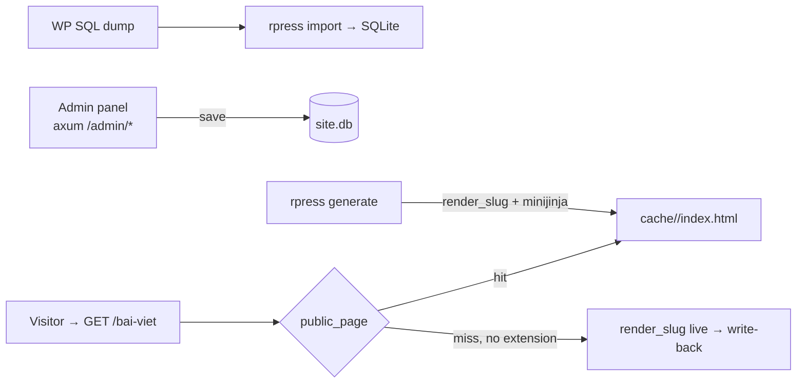

# rpress

A migration-first WordPress news/content-site replacement that serves static
files — written in Rust, shipping as a small binary with SQLite bundled.

rpress is built for one job: take over an existing WordPress content site
**without changing the public site or the editors' core workflow**. The admin
reproduces the wp-admin screens that news sites need — posts, pages, media,
comments, users, menus, widgets, revisions, quick-edit, bulk actions — and the
front end serves pre-rendered HTML straight from disk.

This is a **structural conversion**, not a port: WordPress's request-time PHP
rendering is replaced by a publish-time static build. That trade is the whole
point — and it is not free.

The current strategic boundary is deliberate: **migration parity first,
AI/CLI/MCP operations second**. rpress owns content state and publication;
external providers should own heavy commerce, mail delivery, identity beyond
editor login, and other domain-specific workflows.

## The trade, honestly

**Running WordPress on a VPS today means:**

- PHP-FPM + MySQL/MariaDB + nginx/Apache — three services to patch, tune,
  and watch.
- Every request boots WP core, loads every active plugin, runs 50–200 SQL
  queries. A $5 VPS falls over at a few hundred concurrent visitors.
- Attack surface is the product: `wp-login.php`, `xmlrpc.php`, plugin
  vulnerabilities, theme vulnerabilities. Wordfence exists because it is
  needed.
- Caching plugins (WP Super Cache…) bolt static output on top of a dynamic
  engine — two systems to maintain, and the cache still expires, purges, and
  desyncs.

**With rpress:**

- One binary + one `.db` file + one `cache/` directory. Deploy is `scp`.
- A public request is `fs::read` of a pre-rendered file — 100–1000× less
  work than a PHP request. The Rust process is idle most of the time.
- An attacker `GET /wp-admin` hits a 404 — that path literally does not
  exist in the binary.
- **But**: you lose the PHP plugin ecosystem. Themes and plugins don't
  *run* — their output is reproduced at render time. Contact-form plugins,
  page builders, slider plugins each need a port into `src/` or a template
  equivalent. This repo ships the parity the reference sites needed
  (Tourmaster, GoodLayers metaboxes, CF7/Flamingo inbox, wpDiscuz comments);
  a new plugin means writing Rust or accepting the gap.
- **And**: dynamic-per-request features (real-time personalization,
  server-side A/B, logged-in visitor content) have no home in a static
  serve path. Admin and intake endpoints are dynamic; the public site is
  deliberately not.

If your site is content — posts, pages, galleries, comments, reviews,
newsletter/contact intake, SEO pages — the trade is strongly in your favor. If
your site is a full store, a forum, or a membership app, it is not: keep
WordPress or integrate a specialized provider.

| | WordPress | rpress |
|---|---|---|
| Request path | PHP boot → 50–200 MySQL queries → plugin hooks | `fs::read` one cached HTML file |
| Render | Every request | Once on publish / first hit (render-on-miss safety net) |
| Deploy | PHP-FPM + WP + MySQL/MariaDB + themes/plugins | One binary + one `.db` file |
| Attack surface | ~60k plugin CVEs, `wp-admin`, `xmlrpc` | Rust binary, persistent SQLite sessions, argon2, CSRF per session, hardened local asset serving |
| Memory | ~500 MB+ (PHP workers + MySQL) | ~30 MB |
| Plugin ecosystem | 60k+ plugins | What is ported in `src/`; gap is real |
| Dynamic public pages | Yes | No — by design |

## Features

- **Posts / Pages / Tours** — list screens, editor, Quick Edit, bulk actions,
  revisions, trash, preview (session-gated, `noindex`).
- **Comments** — moderation queue, reply, quick-edit, spam/trash, auto-approved
  comments trigger background re-render of the post.
- **Users** — roles, application passwords, profile, self/last-admin guards.
- **Media** — library, attachment editor, canvas replace, regenerate sizes.
- **Menus / Taxonomies / Widgets** — WP-parity editors; widget html accepts
  `{{ site_url }}`/`{{ lang }}` jinja.
- **SEO** — Rank Math–compatible meta (title, description, OG/Twitter cards,
  canonical, JSON-LD), sitemap, RSS feed, `robots.txt`, `llms.txt`.
- **Public intake** — comments and reviews, rate-limited, CORS-scoped.
- **Markdown mirrors** — every page also serves `GET /<slug>.md` and
  `Accept: text/markdown`; `llms.txt` indexes the whole site.
- **Multilingual (N languages)** — languages imported from Polylang into
  `post_translation_members(group_id, lang, post_id)`; any non-primary
  language renders under `/<lang>/`, hreflang alternates for every
  translation member, per-language feeds/search/archives, template fallback
  `base_<lang>.html` → primary, sidebar/footer per-lang with primary
  fallback. Public render is N-language; the admin edit screen still
  exposes the legacy two-language pairing.
- **SPA- Feel navigation** — `nav.js` prefetch-on-hover + same-origin DOM
  swap; theme JS re-init via the `rpress:swapped` hook.
- **Agent-ready surface** — deterministic CLI commands, markdown mirrors, and
  `llms.txt` make the migrated site inspectable and operable by AI agents while
  the human admin remains available for review/fallback edits.

## The model



Public requests are `fs::read` of a pre-generated file. If the file is missing
(deleted, page not yet generated) the server renders it live once and writes it
back — the same trick WP caching plugins approximate. nginx or a CDN can front
`cache/` and `www/` directly for even faster serving.

## Quick start — migration path

```bash
cargo build --release

# Point at a WP SQL dump; rpress imports, creates an admin user,
# renders every page into cache/, and prints the credentials.
./target/release/rpress migrate dump.sql --db rpress.db \
    --templates templates --out cache --www www \
    --site-url https://example.com

# Then serve.
./target/release/rpress serve --site default --db rpress.db \
    --templates templates --out cache --www www --bind 127.0.0.1:8000
```

Admin: `http://127.0.0.1:8000/admin` — the password was printed by
`migrate`. See `CMS-OPERATIONS.md` for nginx fronting and multi-site
layout.

The steps are also available separately: `rpress import parse`,
`rpress import verify`, `rpress generate`, `rpress user add` — for partial
reruns and debugging. `migrate` is the happy path.

## E2E site workflow

For a repeatable dump → assets → import → configure → generate → verify run
against a **test clone** (never production), use `scripts/e2e-site.sh` with a
per-site env file — see `WORKFLOW.md` and `sites/_template.env`:

```bash
cp sites/_template.env sites/mysite.env   # fill source + local URL
./scripts/e2e-site.sh sites/mysite.env pull       # rsync dump + wp-content + wp-includes
./scripts/e2e-site.sh sites/mysite.env import     # parse + verify counts
./scripts/e2e-site.sh sites/mysite.env configure  # local URLs, admin user
./scripts/e2e-site.sh sites/mysite.env generate   # render cache/
./scripts/e2e-site.sh sites/mysite.env check      # sampled routes per language
./scripts/e2e-site.sh sites/mysite.env parity     # origin-vs-local markup gate
./scripts/e2e-site.sh sites/mysite.env serve      # local server
```

`configure` records `asset_origin` (missing-asset fallback) and
`legacy_origin` (render-time URL rewrite), sets `site_url` to the local URL,
and rewrites plain-text URL columns (`menu_items.url`,
`redirects.new_url`). `pull` refuses non-test sources unless
`CLONE_SOURCE_OK=yes`.

## Layout

```
src/
  admin/        axum server — wp-admin screen equivalents
  db/           every SQL statement lives here; sql/*.sql loaded via include_str!
  render*.rs    public page render + cache write-back
  generate.rs   bulk warm/refresh (not the serving path)
  intake.rs     public comment/review intake
  lang.rs       language config + N-language path/template helpers
  sitefx.rs     sitemap, feeds, robots.txt, 404, redirects.map, llms.txt
  schema.rs     DDL owner
templates/      minijinja templates — admin/ + public theme shells (base_<lang>.html)
scripts/        e2e-site.sh — repeatable dump→serve workflow per site env
sites/          per-site env configs (source, local URL, clone opt-in)
www/            persistent public assets (front.css, nav.js, uploads, wp-includes)
docs/           architecture, code standards, API reference
```

## Project status

Post-split hardening is complete and the E2E migration workflow exists:
a test-site clone (~4.9 GB wp-content, 294 MB dump) imports, renders
~1240 pages with zero failures, and serves locally with all theme/plugin/
core assets local (no remote fallback needed for normal pages). Remaining
gaps: admin translation editing is still the legacy FR/ES pairing UI
(public render is already N-language), `term_translations` pairing is
two-language, and `pagefind` must be installed for site search.

Some theme-specific markup lives in `templates/` as the reference theme;
swapping a theme means swapping templates + `www/` assets — see
`docs/architecture.md` for the contract nav.js and `filter_content` rely on.

## License

MIT
