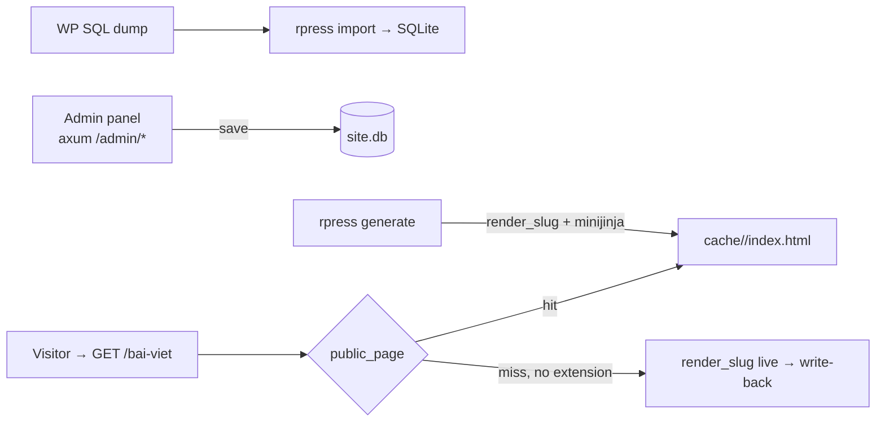

# rpress

A migration-first WordPress news/content-site replacement that serves static
files — written in Rust, shipping as a small binary with SQLite bundled.

rpress is built for one job: take over an existing WordPress content site
**without changing the public site or the editors' core workflow**. The admin
reproduces the wp-admin screens that news sites need — posts, pages, media,
comments, users, menus, widgets, revisions, quick-edit, bulk actions — and the
front end serves pre-rendered HTML straight from disk.

This is a **structural conversion**, not a port: WordPress's request-time PHP
rendering is replaced by a publish-time static build. That trade is the whole
point — and it is not free.

The current strategic boundary is deliberate: **migration parity first,
AI/CLI/MCP operations second**. rpress owns content state and publication;
external providers should own heavy commerce, mail delivery, identity beyond
editor login, and other domain-specific workflows.

## The trade, honestly

**Running WordPress on a VPS today means:**

- PHP-FPM + MySQL/MariaDB + nginx/Apache — three services to patch, tune,
  and watch.
- Every request boots WP core, loads every active plugin, runs 50–200 SQL
  queries. A $5 VPS falls over at a few hundred concurrent visitors.
- Attack surface is the product: `wp-login.php`, `xmlrpc.php`, plugin
  vulnerabilities, theme vulnerabilities. Wordfence exists because it is
  needed.
- Caching plugins (WP Super Cache…) bolt static output on top of a dynamic
  engine — two systems to maintain, and the cache still expires, purges, and
  desyncs.

**With rpress:**

- One binary + one `.db` file + one `cache/` directory. Deploy is `scp`.
- A public request is `fs::read` of a pre-rendered file — 100–1000× less
  work than a PHP request. The Rust process is idle most of the time.
- An attacker `GET /wp-admin` hits a 404 — that path literally does not
  exist in the binary.
- **But**: you lose the PHP plugin ecosystem. Themes and plugins don't
  *run* — their output is reproduced at render time. Contact-form plugins,
  page builders, slider plugins each need a port into `src/` or a template
  equivalent. This repo ships the parity the reference sites needed
  (Tourmaster, GoodLayers metaboxes, CF7/Flamingo inbox, wpDiscuz comments);
  a new plugin means writing Rust or accepting the gap.
- **And**: dynamic-per-request features (real-time personalization,
  server-side A/B, logged-in visitor content) have no home in a static
  serve path. Admin and intake endpoints are dynamic; the public site is
  deliberately not.

If your site is content — posts, pages, galleries, comments, reviews,
newsletter/contact intake, SEO pages — the trade is strongly in your favor. If
your site is a full store, a forum, or a membership app, it is not: keep
WordPress or integrate a specialized provider.

| | WordPress | rpress |
|---|---|---|
| Request path | PHP boot → 50–200 MySQL queries → plugin hooks | `fs::read` one cached HTML file |
| Render | Every request | Once on publish / first hit (render-on-miss safety net) |
| Deploy | PHP-FPM + WP + MySQL/MariaDB + themes/plugins | One binary + one `.db` file |
| Attack surface | ~60k plugin CVEs, `wp-admin`, `xmlrpc` | Rust binary, persistent SQLite sessions, argon2, CSRF per session, TOTP 2FA, multi-header/stale-cookie tolerant auth, hardened local asset serving |
| Memory | ~500 MB+ (PHP workers + MySQL) | ~30 MB |
| Plugin ecosystem | 60k+ plugins | What is ported in `src/`; gap is real |
| Dynamic public pages | Yes | No — by design |

## Features

- **Posts / Pages / Tours** — list screens, editor, Quick Edit, bulk actions,
  revisions, trash, preview (session-gated, `noindex`).
- **Comments** — moderation queue, reply, quick-edit, spam/trash, auto-approved
  comments trigger background re-render of the post.
- **Users** — roles, application passwords, profile, self/last-admin guards,
  optional TOTP two-factor per account (QR enrollment on the profile page,
  second factor prompted at login once enabled).
- **Media** — library, attachment editor, canvas replace, regenerate sizes.
- **Menus / Taxonomies / Widgets** — WP-parity editors; widget html accepts
  `{{ site_url }}`/`{{ lang }}` jinja.
- **SEO** — Rank Math–compatible meta (title, description, OG/Twitter cards,
  canonical, JSON-LD), sitemap, RSS feed, `robots.txt`, `llms.txt`.
- **Public intake** — comments and reviews, rate-limited, CORS-scoped.
- **Markdown mirrors** — every page also serves `GET /<slug>.md` and
  `Accept: text/markdown`; `llms.txt` indexes the whole site.
- **Multilingual (N languages)** — languages imported from Polylang into
  `post_translation_members(group_id, lang, post_id)`; any non-primary
  language renders under `/<lang>/`, hreflang alternates for every
  translation member, per-language feeds/search/archives, template fallback
  `base_<lang>.html` → primary, sidebar/footer per-lang with primary
  fallback. Public render and the admin edit screen are both N-language
  (`settings.languages`); the legacy `post_translations` pair table was
  dropped — migration `m05` backfilled it into members.
- **SPA- Feel navigation** — `nav.js` prefetch-on-hover + same-origin DOM
  swap; theme JS re-init via the `rpress:swapped` hook.
- **Agent-ready surface** — deterministic CLI commands, markdown mirrors, and
  `llms.txt` make the migrated site inspectable and operable by AI agents while
  the human admin remains available for review/fallback edits.
- **Plugin bridge** — plugins that opt in get a real wp-admin surface: a
  sandboxed `php -S` child (symlinked `wp-includes` + hardlinked
  `wp-admin` + skeleton `wp.db`, ~88MB RSS, ~100ms warm request,
  ~2.6s cold respawn) proxied at `/admin/plugin-<slug>/*`; rpress
  sessions auto-login via a mu-plugin and whitelisted writes pull back
  into `rpress.db`. Falls back to `@wp-playground/cli` (WASM PHP) on
  hosts without `php`. See `docs/architecture.md` → Decisions.

## The model



Public requests are `fs::read` of a pre-generated file. If the file is missing
(deleted, page not yet generated) the server renders it live once and writes it
back — the same trick WP caching plugins approximate. nginx or a CDN can front
`cache/` and `www/` directly for even faster serving.

## Install on a Linux VPS — one command

```bash
curl -fsSL https://raw.githubusercontent.com/hieuspaceos/rpress/main/install.sh | bash
```

(or clone the repo and run `./install.sh` directly). The script installs a
released Linux
binary when one exists, otherwise builds from source; runs `site init` to
import the WP dump; writes + starts a hardened `rpress-<slug>` systemd
unit; and prints the nginx proxy block. No PHP/MySQL needed for the core —
`php-cli`+`bubblewrap` only if the site opts into the plugin bridge.

## Quick start — migration path

```bash
cargo build --release

# Point at a WP SQL dump; rpress imports, creates an admin user,
# renders every page into cache/, and prints the credentials.
./target/release/rpress migrate dump.sql --db rpress.db \
    --templates templates --out cache \
    --site-url https://example.com

# Then serve.
./target/release/rpress serve --site default --db rpress.db \
    --templates templates --out cache --www www --bind 127.0.0.1:8000
```

Admin: `http://127.0.0.1:8000/admin` — the password was printed by
`migrate`. See `CMS-OPERATIONS.md` for nginx fronting and multi-site
layout.

The steps are also available separately: `rpress import parse`,
`rpress import verify`, `rpress generate`, `rpress user add` — for partial
reruns and debugging. `migrate` is the happy path.

## E2E site workflow — `rpress site`

The full WP clone → localhost sandbox → deploy pipeline is built into the
binary. A wizard prompts on a TTY; every question has a flag twin so agents
run fully non-interactive:

```bash
rpress site init   mysite   # probe ssh | local | archive → sites/mysite.env
rpress site build  mysite   # pull→import→configure→generate→check, per-phase
                            # ok/warn/fail + --from <phase> resume + --json
rpress site serve  mysite   # sandbox + per-language test checklist
rpress site serve  mysite --smoke    # probe routes on a throwaway port, exit
rpress site deploy mysite --target static \
    --domain https://example.com --dest user@host:/var/www/site --yes
```

- `init` **probes** instead of asking: on `--source ssh` it finds
  `wp-config.php`, reads DB creds, lists or exports dumps (`wp-cli`/
  `mysqldump`), and reads `siteurl` from the live DB. `--source local` scans
  a dir for `*.sql` + `wp-content`; `--source archive` unpacks
  `.zip/.tar(.gz)/.sql.gz` first. `--ssh` takes `user@host` or a `vps.sh`
  alias (password/keyfile hosts).
- `deploy` requires an explicit `--domain` (never derived from the source)
  and refuses `domain == source origin`. Targets: `static` (rsync docroot —
  no admin/comments), `pages` (Cloudflare Pages via wrangler), `vps` (full
  app payload + printed nginx/systemd runbook). `--dry-run` previews.
- Remote pulls are clone-only: `CLONE_SOURCE_OK=yes` in the env or `--clone-ok`.

### Shell fallback

The same `sites/<name>.env` drives `scripts/e2e-site.sh` — see `WORKFLOW.md`:

```bash
cp sites/_template.env sites/mysite.env   # or let `site init` write it
./scripts/e2e-site.sh sites/mysite.env all      # pull→import→configure→generate→check
./scripts/e2e-site.sh sites/mysite.env parity   # origin-vs-local markup gate
./scripts/e2e-site.sh sites/mysite.env serve
```

`configure` records `asset_origin` (missing-asset fallback) and
`legacy_origin` (render-time URL rewrite), sets `site_url` to the local URL,
and rewrites plain-text URL columns (`menu_items.url`,
`redirects.new_url`).

### Visual smoke checklist

`scripts/visual_smoke.sh` is the structural render gate for the
site-agnostic chrome work (plan `261028-site-agnostic-chrome`). Run it
after touching `templates/theme/`, menu/site_data plumbing, or plugin
migrate code:

```bash
./scripts/visual_smoke.sh              # all sites
./scripts/visual_smoke.sh blueskies    # one site
```

Gate contract: per site it renders known slugs and asserts no `{{ }}`
leakage, no foreign-theme chrome (`traveltour` on tevily sites, aucoeur
strings elsewhere), menu presence, and — for aucoeur-test only — byte
parity of nav `<li>` sequence + footer text against
`tests/fixtures/aucoeur-*-baseline.txt` (recapture via the fixture
comments after intentional chrome changes).

### Bridge e2e gate

`scripts/e2e-bridge.sh` is the live proof for the PHP bridge — unit
tests can't spawn `php -S`, so token/header/URL-rewrite regressions only
show here. Run it after touching `src/admin/bridge/**` or the dispatch
code in `src/admin/mod.rs`:

```bash
./scripts/e2e-bridge.sh aucoeur-test            # default 127.0.0.1:8430
```

It starts a real server, logs in, then asserts: proxied pages return
200, `Location`/body URLs never leak `127.0.0.1:<port>`, the raw bridge
port 403s without the bearer and 204s `/__rpress_ident` with it, and
the admin-ajax pipe is live.

### Declarative plugin adapters — `plugins/specs/*.toml`

New WP plugin stacks on-board without Rust: drop a TOML spec into
`plugins/specs/` (embedded at build time by `build.rs`, parsed at
startup — a bad spec fails loudly, never silently skips):

```toml
slug = "babe"
claim_types = ["to_book"]       # wp post_type → kind (must match a kinds[].kind)
option_prefixes = ["babe_"]     # settings keys the stack owns

[[kinds]]
kind = "to_book"
section = "bookings"            # /admin/bookings
noun = "Tour"
url_base = "booking"            # public path segment (empty = root)
# origin_base = "to_book"       # only when the WP path differs from url_base
taxonomies = ["categories", "ba_location", "ba_type", "ba_features"]
harvest = true                  # render = origin HTML fetched once at import
```

- `harvest = true` kinds fetch origin-rendered HTML **once at import**
  (needs `siteurl` live then — port-once), store it in
  `harvested_pages`, and generate emits it verbatim; re-generates work
  with a dead origin. CF7 `<form action>`s are rewritten to
  `/form/enquiry` (seeded form row, `additional='harvest-seed'`).
- `harvest = false`/absent → the generic bare-body render path.
  Rust adapters keep priority: a spec colliding with a Rust kind/section
  fails startup on the same duplicate asserts.
- `[[screens]]` adds a settings screen and `[kinds.metabox]` a flat
  `post_meta` metabox inside the kind's editor (same
  `save_settings_fields` path as Rust screens; field kinds:
  `text`/`textarea`/`select`/`checkbox`/`serialized`/`note`). See
  `plugins/specs/babe.toml` for both.
- Full editor/save semantics beyond flat meta still need a Rust
  `PluginAdapter` (`tourmaster` stays Rust); specs cover claim + list +
  settings + metabox + render-by-origin.

### Declarative themes — `themes/specs/*.toml`

A new theme onboards without touching `src/`: a spec in
`themes/specs/` (same `build.rs` codegen as plugin specs) plus
`templates/theme/<dir>/base_<lang>.html`:

```toml
stylesheet_patterns = ["tevily", "tevily-*"]   # matched against the site's stylesheet
template_dir = "tevily"
body_class = "tevily-body"
sidebar_wrap_class = "content-container sidebar-wrap"
settings_key_prefix = "tevily_"
menu_renderer = "caret"
```

Render/admin resolve the theme via `theme_for_site(conn)` — Rust
adapter → TOML spec → `DEFAULT_THEME` — never `theme_traveltour::*`
directly; taxonomy-map reads (`cat_path`, `tag_base`, `cat_children`,
per-language taxonomy roots) go through the shared `theme_*` API keyed
on `ThemeDef::taxonomy_map_key`. A Rust `PluginAdapter::theme()`
remains the escape hatch and wins on collision (startup panics on a
duplicate). Sites whose stylesheet matches nothing render through
`templates/theme/default/` (neutral base, no brand chrome).
`themes/specs/tevily.toml` is the TOML demo; `theme_traveltour` stays a
Rust adapter because it seeds sidebars/widgets/custom-css and owns the
byte-parity `wrap_page_sidebar`. `scripts/check-layers.sh` rules 4–5
gate new site/theme literals in `src/`.

### Site onboarding detect — `rpress detect`

Before pulling a new site, `rpress detect --dump work/<site>/dump.sql
--www work/<site>/www` maps its WP surface onto rpress's backend tiers:

- **theme** — `stylesheet`/`template` → ThemeDef (Rust → TOML spec →
  default fallback), plus every theme dir on disk
- **active plugins** — each `dir/file.php` → registered adapter +
  `Backend`, or NO adapter. A `--www` marker scan flags tier-3
  builders (`Widget_Base`, `page_builder_element`, `WPBakeryShortCode`,
  `et_pb_module`); `· registers <cpt>` notes the post types each
  plugin owns — a real `register_post_type` scan over plugin AND
  theme dirs (`theme:<dir>` label), resolving literal slugs plus
  `self::$var`/`Class::CONST`/`$var` declarations in the same file.
  Plugins present on disk but inactive list separately.
- **post types** — claimed (and by whom) vs UNCLAIMED with row counts
- **shortcodes** — tags actually used in `post_content` (CF7 form
  notation excluded) — the rendering surface adapters must cover
- **wp_options** — first-segment prefix groups → whitelisted under an
  adapter's `option_prefixes` or not; WP core/transients fold into
  `wp-core/misc`

Output ends with the `PLUGINS_PHP=` line and `claim_types` draft
hints. Attribution is structural (register_post_type/option prefixes);
the `Backend` choice stays a human decision.


### Revolution Slider fragments — `harvested_fragments`

Pages whose builder JSON carries a `revolution-slider` element can't
re-render the slider from the dump (RevSlider keeps slide data in
plugin tables outside the WP export). At import the origin page is
fetched once and its rendered `<rs-module-wrap>` markup — plus the
`<script id="rs-initialisation-scripts">` footer init and any adjacent
slider config `<style>`/`<script>` blocks — is stored in
`harvested_fragments(post_id)`. The `revolution-slider` element then
emits that fragment verbatim at render, preceded by the rs6 assets
(`rs6.css`, `rbtools.min.js`, `rs6.min.js`, `setREVStartSize`) served
from `www/wp-content/plugins/revslider/` (pulled with wp-content).
Origin URLs are rewritten to `{{ site_url }}` like `harvested_pages`
and protocol-relative `//origin` refs likewise; a post without a
fragment row renders the element's wrapper-only fallback. Port-once:
the origin only has to be live at import.

### Plugin settings & migration (operator notes)

- Plugin-registered adapters (e.g. `tourmaster`, `theme-traveltour`)
  namespace their `settings` rows as `plugin:<slug>:<key>`. Pre-seam bare
  keys (`tourmaster_general`, `tour_custom_taxs`) are **folded once at
  boot** (`migrate_all`): an `INSERT OR IGNORE` copy — the legacy row is
  kept, already-namespaced rows are never overwritten, re-boots are
  no-ops. Reads prefer the namespaced key and fall back to the bare one,
  so sites work before, during, and after the fold.
- `post_meta` `tourmaster-*` keys are the plugin's wire format — they
  are *not* namespaced and never will be (the adapter round-trips the
  same keys the WP plugin wrote).
- `TOUR_BASE` / `--tour-base` are permanent env/CLI names — deploy
  emits them unchanged; they resolve into the tour kind's URL base via
  `KindBases`.


## Layout

```
src/
  admin/        axum server — wp-admin screens + public serve (serve.rs)
  db/           SQL statement text lives in db/sql/*.sql; helpers re-export
  plugins/      cross-layer adapter registry (kinds, screens, hooks)
  render*.rs    public page render + cache write-back
  generate.rs   bulk warm/refresh (not the serving path)
  intake.rs     public comment/review intake
  lang.rs       language config + N-language path/template helpers
  sitefx.rs     sitemap, feeds, robots.txt, 404, redirects.map, llms.txt
  schema.rs     DDL owner
templates/      minijinja templates — admin/ + public theme shells (base_<lang>.html)
scripts/        e2e-site.sh — dump→serve workflow; check-layers.sh — architecture gate; e2e-bridge.sh — live php-bridge gate
plugins/specs/  declarative plugin adapters (baked into the binary by build.rs)
themes/specs/  declarative themes (stylesheet match → ThemeDef; same codegen)
install.sh     one-command Linux VPS installer
sites/          per-site env configs (source, local URL, clone opt-in)
www/            persistent public assets (front.css, nav.js, uploads, wp-includes)
docs/           architecture, code standards, API reference
```

## Project status

Post-split hardening is complete and the E2E migration workflow exists:
a test-site clone (~4.9 GB wp-content, 294 MB dump) imports, renders
~1240 pages with zero failures, and serves locally with all theme/plugin/
core assets local (no remote fallback needed for normal pages). The
site-agnostic core landed: admin and public render are N-language
(`settings.languages`, members-based pairing), `post_translations` is
dropped via `schema_migrations` `m05`, themes on board declaratively
(`themes/specs/*.toml` + `templates/theme/<dir>/`), and
`check-layers.sh` gates new site/theme literals in `src/`. Remaining
gaps: `term_translations` pairing is still two-language, and `pagefind`
must be installed for site search. The importer also populates the
`terms` table from `wp_term_taxonomy` (required by category widgets and
term archives — Polylang internals are skipped).

Theme markup lives in `templates/theme/<dir>/` keyed by the spec's
`template_dir`; unmatched sites fall back to `templates/theme/default/` —
see `docs/architecture.md` for the contract nav.js and `filter_content`
rely on.

## License

MIT
