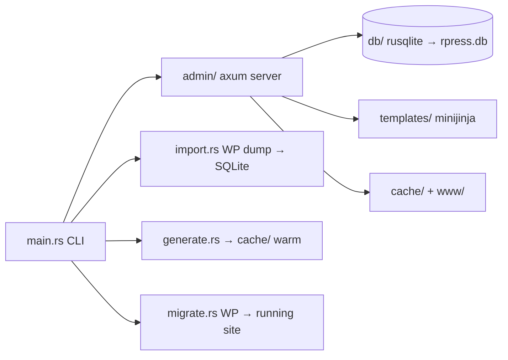
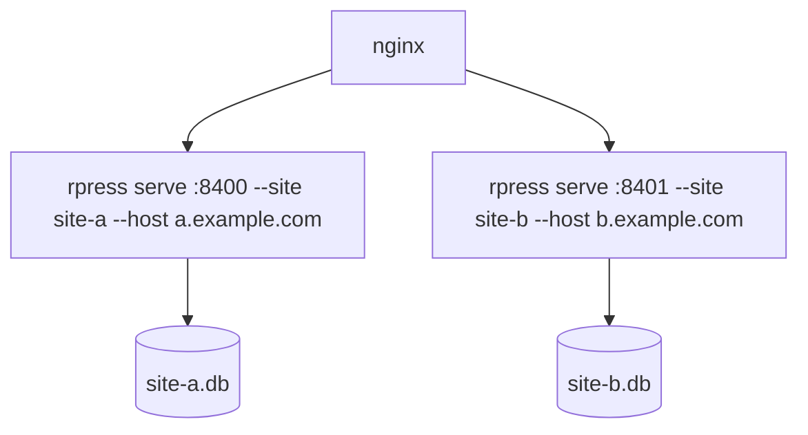

# Architecture — rpress

One site-agnostic binary, three layers, WP-shaped names on purpose.

## Layers

| Layer | Directory | Owns | May import |
|---|---|---|---|
| Admin (HTTP) | `src/admin/` | routes, HTML screens, auth guards, forms, **public serving** (`serve.rs`: cache hit → `fs::read`, miss → render + write-back, uploads/wp-asset fronting) | `db`, `intake`, `sitefx`, `render`, `plugins` |
| Data | `src/db/` | every SQL statement (`sql/*.sql` via `sql!()`), term/post/media mutation helpers | nothing (rusqlite only) |
| Plugin kernel | `src/plugins/` | adapter registry: `KindDef`/`ScreenDef`/import+render hooks — the one sanctioned cross-layer import (admin screens AND render AND import all consult it) | `db`, `admin` (screen ctx) |
| Site output | `src/render*.rs`, `src/generate.rs`, `src/intake.rs`, `src/sitefx.rs` | page render + cache write-back + public intake + utility-file emit | `db`, `plugins` |

Rule: **SQL statement text lives only in `src/db/sql/`** — loaded via the
`sql!()` macro. Callers embed `sql!("name")`; no `.rs` file outside `db/`
may hold a SQL literal (exceptions: `src/plugins/` adapter internals,
`import.rs`/`sqldump.rs` dump-parsing — their statements are dynamic or
plugin-owned). Rendering helpers (`esc`, `chrome`, `html_admin`, `need_auth`)
live in `src/admin/mod.rs` and are `pub(crate)` for siblings.

## Sites — multisite by process

The binary is site-agnostic; the *process* is bound to one site via CLI args.
`App.sites` is a `Host → SiteCtx` map so one process CAN serve several hosts,
but the normal layout is **one process per site, one `.db` per site** —
the WP-multisite equivalent with stronger isolation (a crash or bad import on
one site never touches another's data). nginx maps each host to its port.

`SiteCtx` carries everything site-local:

| Field | Source |
|---|---|
| `slug` | `--site` — session scoping key |
| `name` | `--name` — admin chrome brand |
| `db`, `templates`, `out`, `www` | `--db`/`--templates`/`--out`/`--www` — `out` is the disposable cache; `www` holds persistent uploads + vendored assets |
| `tour_base` | `--tour-base` — CPT URL segment |
| `generating` | per-site generate flag |

**`need_auth(&app, &headers) → (Sess, &SiteCtx)`** is the single entry:
handlers never call `site_for` separately and never touch `app.db` directly —
there is no `app.db`. Unknown `Host` falls back to `default_site` so
single-site dev needs no flags beyond `--site default`.

Site-shared in `App` only: `sessions` (keyed per-site via `Sess.site` — a
token minted on site A is rejected on site B), `login_hits`, `intake_rate`,
`miss_rate` (60/min/IP cap on public render-miss work).

**Nothing in `src/` names a domain.** The public base URL for permalinks and
CORS origins comes from `settings.site_url` in that site's own DB
(`site_url(sc)`, `allowed_origins(sc)`). A second origin rewrite is
`settings.legacy_origin`: when non-empty, `render_post::rewrite_origin`
replaces it with `settings.site_url` in post content (set it to the
imported WP domain; empty = no rewrite).

## `src/admin/` module map (wp-admin equivalents)

| File | WP analog | Contents |
|---|---|---|
| `mod.rs` | `wp-admin/admin.php` + `admin-header.php` | `serve()` router, `App`/`Sess`, sessions, `need_auth`, `chrome*` sidebar, `menu_li`/`menu_li_badge`, `esc`, `html_admin` — the **kernel** only; public serving is in `serve.rs` |
| `serve.rs` | the public `index.php` | `public_root`/`public_page` (cache-hit read → miss render+write-back, miss-rate limiter, canonical-301 gate), `write_cache` (tmp+rename), `.md` negotiation, `wp_asset`/`uploads`/`front_css` static fronting, `publish_due`, `purge_alias_caches` |
| `auth.rs` | `wp-login.php` | login page/handler, logout, dashboard |
| `list.rs` | `class-wp-list-table.php` | shared `subsubsub` views, `tablenav` bulk+pager, `row_actions`, `thead`, `empty_row`, `back_or` |
| `posts.rs` | `edit.php`, `post.php`, `post-new.php` | list screen (`render_list`), row actions (trash/clone/quick-edit/bulk), post editor (`edit_html`), save |
| `comments.rs` | `edit-comments.php`, `comment.php` | views w/ counts, per-status row actions, reply, quick-edit, edit (status radios + date), bulk, Empty Spam/Trash |
| `users.rs` | `users.php`, `user-new.php`, `user-edit.php`, `profile.php` | role views, create/edit/delete confirm screen, change-role bulk, self/last-admin guards, `drop_sessions_for` |
| `contact.rs` | CF7 list + Flamingo inbox | `forms_page` (FORM_SLUGS registry), `inbox_page` (Inbox/Spam/Trash, sortable), `detail_page`, moderation via `intake::moderate`, `/admin/submissions` 301s |
| `menus.rs` | `nav-menus.php` | selector+create/delete, add-items metaboxes (Pages/Posts/Tours/Custom/Categories), item blocks (Original:, move links, Remove), save_tree tx |
| `tax.rs` | `edit-tags.php` | Categories/Tags two-column screen, save/delete/bulk |
| `admin.rs` | `upload.php`, APIs | media, static-generate + status, `api/v1/posts` JSON, intake handlers |
| `bridge/` | a real wp-admin for opted-in plugins | `mod.rs` runtime pick + state map + proxy, `php_cgi.rs` (`php -S` + sandbox-exec/bwrap, preferred), `playground.rs` (WASM fallback), `http.rs` cookie/header translation, `mu-plugin/bridge.php` (rpress-session auto-login, write whitelist pull-back) |

## `src/plugins/` — cross-layer kernel (top-level)

| File | Contents |
|---|---|
| `mod.rs` | `PluginAdapter` trait, `KindDef`/`ScreenDef`/`RenderCtx` registry (`adapters()`, `kind_def`, `adapter_for_kind`, `screen_for`, `resolve_bases`, `migrate_all`) — the one sanctioned seam every layer (admin screens, render, import) consults; also `ThemeDef` + the `theme_*` taxonomy-map API (`theme_for_site`, `theme_cat_path`, `theme_tag_base`, `theme_cat_children`, `theme_taxonomy_base`, `theme_cat_lang`, `theme_tax_lang`, `theme_tax_label`) + `DEFAULT_THEME` (neutral fallback) |
| `spec.rs` | declarative adapter specs from `plugins/specs/*.toml` → generated `KindDef`s, `ScreenDef` settings screens (`[[screens]]` + `fields` — same `save_settings_fields` path as Rust screens), and generated `EditorHooks` (`[kinds.metabox]` — flat `post_meta` fields, quick-edit safe). Field kinds: `text`/`textarea`/`select`/`checkbox`/`serialized`/`note`. Rust-only: render hooks, import `post_imported`, `submenu()`/`seeds()`/`widget_*`, bridge backends |
| `themes.rs` | declarative theme specs from `themes/specs/*.toml` (same build.rs codegen) — URL shapes/class prefixes/admin labels; Rust `PluginAdapter::theme()` is the escape hatch and wins on collision (panic at `migrate_all`) |
| `tourmaster/` | Tour kind (Rust port): schema, elements, screens, render |
| `goodlayers/` | PhpBridge adapter boot + write spec |
| `misc.rs` | wpDiscuz / CF7 / MetaSlider / Site-Reviews settings screens |
| `chaty.rs` | Chaty settings |
| `theme_traveltour/` | theme adapter + seed assets — `ThemeDef` fields drive the generic `theme_*` API; its old `cat_path`/`tag_base` readers retired here (phase 05) |

## `src/db/` module map (wp-includes equivalents)

| File | WP analog | Contents |
|---|---|---|
| `mod.rs` | — | `slugify`, `attach_term`, `term_name`; re-exports all submodules |
| `posts.rs` | `post.php` | `PostForm`, `load_post`, `save_post`, `list_admin`, `clone_post`, `quick_update`, `bulk_apply`, `set_post_status`, admin-support queries (`tag_names_for`, `lang_of`, `media_choices`, `media_path`, `published_at`) |
| `comments.rs` | `comment.php` | `counts`, `list(Filter)`, `get`, `set_status`, `update_fields`, `delete_permanent` (re-parents children in same tx), `insert_reply`, `empty_status` |
| `users.rs` | `user.php` | `counts_by_role`, `list`, `get`, `create`, `update`, `delete`, `count_admins`, `change_role` |
| `submissions.rs` | — | `counts`, `form_counts`, `list(Filter)` (sortable), `get`, `set_status`, `purge` |
| `menus.rs` | `nav-menu.php` | `list_menus`, `get_menu`, `list_items`, `create_menu`, `rename_menu`, `delete_menu`, `save_tree`, `add_items`, `move_item`, panel queries |
| `terms.rs` | `taxonomy.php` | `TermRow`, `list_terms`, `save_term`, `delete_term`, `term_choices`, `term_slugs_for`, `terms_for`, `set_terms`, `taxonomy_exists` |
| `media.rs` | `media.php` | `save_upload` (sanitize + magic-byte mime + image-size derivatives), `media_list/get/update/delete/detach`, `media_months`, `media_regenerate_sizes` |
| `misc.rs` | — | settings/plugin-option helpers, widget/sidebar fns, `body_json` (GoodLayers) helpers, `now_sql`, `insert_draft` |

**`src/db/sql/`** — one `.sql` file per statement (`{module}__{verb}_{noun}.sql`),
loaded at compile time via `sql!("name")` (`include_str!`). Every SQL
*statement text* lives there — callers in `render*`/`admin`/`sitefx` embed
`sql!("name")` (the macro pulls the file contents; nothing outside `db/sql/`
may hold a statement literal). Mutation helpers still go through `db::` fns.

## Data model (owner: `src/schema.rs`)

`posts` (all kinds: post/page/tour via `kind`), `tours` (tour-only columns),
`post_terms` (assignments), `terms` (term registry — needed so
Categories/Tags screens can create terms with no post yet),
`term_translations`, `post_translation_members` (N-language pairing:
`group_id` + `lang` + `post_id`, one row per language in a translation
group), `post_meta`, `media`, `menus`/`menu_items`, `comments`, `submissions`,
`settings` (site_url/site_name/legacy_origin/asset_origin/widgets_dirty
  + misc options), `sidebars`/`widgets` (widget instances — WP-parity model),
`sessions` (persistent login tokens; in-memory map is a hot cache only),
`schema_migrations` (named post-DDL steps — `migrate_conn` runs each once,
recorded; non-additive changes like drops ride this runner).

Language model: `posts.lang` ∈ `settings.languages` (N-language, e.g.
`fr,es` or `fr,es,de`); pairing via `post_translation_members`. The legacy
`post_translations` (FR↔ES pair) table was retired — migration `m05`
backfills pairs into members and drops the table. Secondary-language
taxonomies use suffixed slugs or separate taxonomies (`duracion`,
`region-es`, `estilo`, `perfil`) — imported that way from WP/Polylang;
preserved, not normalized.

## Decisions worth knowing

- **Sessions persist in SQLite, CSRF stays per in-memory session, and tokens are scoped per-site.** Restart can rehydrate a valid `rpress_session` token from the `sessions` table, then mints a fresh CSRF token in memory. `Sess.site` pins the token to one site's `slug` so credentialed access never leaks across vhosts. DB backups therefore contain live auth material until expiry/revocation.
- **`form=` attribute pattern.** `<form>` inside `<tbody>` is dropped by the
  HTML parser, which silently broke Quick Edit submits. Rule: quick-edit and
  bulk forms declare the form *outside* the table; controls inside rows carry
  `form="id"` attributes.
- **Multi-value form keys use `p-{id}` / `d-{id}` / `bcat-{slug}` prefixes**
  (`menus_save` pattern) because axum's `Form<HashMap>` collapses repeated
  keys. Handlers strip prefixes server-side.
- **Bulk edit is additive** (WP behavior): cats/tags are only added, never
  removed; status changes only when a non-empty value is chosen.
- **Clone** duplicates post + terms + meta + tour row + translation link in
  one transaction; "New Draft" = clone with `status=draft`.
- **`INSERT OR IGNORE`** everywhere for terms/assignments — idempotent, no
  race surface for the single-user admin.
- **Quick Edit writes through `quick_update`/`bulk_apply`**, not `save_post`:
  they touch only title/slug/status/lang + cat/tag terms and preserve
  tour taxonomies (`duree`, `region`, …) untouched.
- **No domain literals in `src/` — gated by `check-layers.sh` rules 4–5.**
  Any string naming a host, brand, taxonomy, or URL segment comes from
  `SiteCtx` (CLI), `settings.*` (DB), `ThemeDef`/`KindDef` data, or
  `src/seed/` (reference-theme payloads). Adding a site must never
  require a code change. `src/widgets.rs` SEED_WIDGETS + `src/seed/*.json`
  are the reference theme's default widget set — replace both for your
  own theme. Live-path language codes resolve through `lang::config` —
  never `"fr"`/`"es"` in admin/render code (gate-allow: boot defaults
  where no DB exists yet).
- **Themes are data, not code.** A new theme onboards as
  `themes/specs/foo.toml` (stylesheet patterns, `template_dir`,
  `body_suffix`, `widget_class`/`sidebar_wrap_class`/`body_class`,
  `settings_key_prefix`, `taxonomy_map_key`, `tag_base`, `tax_lang`,
  `tax_pairs` (primary↔twin taxonomy names — `localized_taxonomy`
  resolves the member for a lang), `tax_labels`) +
  `templates/theme/foo/base_<lang>.html` — zero `src/`
  edits. Render/admin call `theme_for_site(conn)` (Rust adapter → TOML
  spec → `DEFAULT_THEME`), never `theme_traveltour::*` directly;
  taxonomy-map reads (`cat_path`, `tag_base`, `cat_children`, es-root
  lang) are the shared `theme_*` API keyed on
  `ThemeDef::taxonomy_map_key` (with `taxonomy_map_json` as the
  compile-time fallback). Sites whose stylesheet matches nothing render
  through `templates/theme/default/` (neutral base, no brand chrome).
  `tevily` is the TOML demo; `theme_traveltour` stays a Rust adapter
  because it seeds sidebars/widgets/custom-css and owns the byte-parity
  `wrap_page_sidebar`.
- **Builder Live Mode loads scoped frontend CSS.** `templates/front-css/*.scoped.css`
  are the theme/plugin stylesheets fetched once from the live site, prefixed to
  `.gdlr-core-pb-livemode` by `scripts/scope-css.py` (re-run it after refreshing
  the raw `.css` files). The pb body also carries `traveltour-body(-front)` so
  `.traveltour-body …` theme rules resolve. Canvas is zoomed to the 1350px
  frontend width via `gdlrLiveScale()` in `asset_tags()` — keep it, else
  %-padded wrappers collapse in the ~860px admin column.
- **text-box content is entity-decoded at render** (`render.rs::render_node`).
  TinyMCE saves store `&lt;h1&gt;`; WP decodes entities on output, so we mirror
  it for the static build and the live-mode preview.
- **Plugin bridge runs native `php -S`, not WASM, when php-cli is installed.**
  `bridge::RuntimeKind::PhpCgi` (`src/admin/bridge/php_cgi.rs`) builds a symlink-
  farm docroot under `www/bridge/<slug>/` (hardlinked WP core, site plugins/
  themes/uploads linked per-child, vendored sqlite drop-in), renders
  `wp-config.php` with the token/theme/plugin constants, then spawns
  `php -S 127.0.0.1:<port>` wrapped in `sandbox-exec` (macOS Seatbelt,
  deny-default: read only docroot/www/templates/system dirs, write only
  `db/` + `uploads/` + site `mu-plugins`, loopback-only network — proven
  denies on `~/.ssh`, `rpress.db`, outbound HTTP). ~86MB RSS vs ~1.2GB for
  `@wp-playground/cli`; warm request ~100ms. WP installs once via a CLI
  `wp_install()` call (not the HTTP wizard — its `wp_remote_get` retries
  cost ~14s inside the sandbox); `wp.db` is disposable per spawn and
  whitelisted writes pull back to `rpress.db`. On hosts without `php`,
  `bridge_for` falls back to `RuntimeKind::Playground` automatically.

## What this is NOT

- No plugin/theme hooks — features are code, deployed with the binary.
- No REST JSON admin API beyond `/api/v1/posts` (list) and `/api/generate*`.
- Public pages are **lazy render-cache, not a baked tree**: `/{*public}`
  serves `cache/<slug>/index.html` when present, else renders on demand
  and writes back (publish-only, atomic tmp+rename). `rpress generate` still
  exists as a bulk warm/refresh tool but is no longer the serving path —
  a cold `cache/` warms itself from traffic. `www/` is the persistent
  sibling (uploads, vendored plugin/theme assets, `llms.txt`, `front.css`,
  `nav.js`) and is what nginx should back up + serve directly.
- Markdown siblings: `cache/<slug>/index.md` serves `GET /<slug>.md` and
  `Accept: text/markdown` requests; `llms.txt` indexes every page + md.
  Source: `render::post_markdown` + `html_to_markdown`.

## Front-end runtime (`www/nav.js`, `www/front.css`)

Every public page ends with `<script defer src="/nav.js">` inside
`base_*.html`, *inside* the swapped content region. `nav.js` is therefore
re-executed on every SPA-style navigation — the file opens with a
`window.__navSwapInit` idempotence guard, and every side effect must be
safe to re-run.

`navigate()` swaps `.traveltour-body-outer-wrapper` (the element that
contains both `<header>` and `<footer>`), merges `<style id>`/`<script id>`
in `<head>` by id (`mergeHeadTags`), revives `<script>`s in the new
content, then re-runs theme JS init that bound to the *old* nodes —
`rebuildMegaMenus()` and `$.fn.superfish`. Anchors `#id` and same-path
`?…#…` URLs bypass swap entirely; `popstate` skips same-path hash hops.
Ownership: `www/nav.js` — see its leading comment for the full contract.

`templates/post_assets.txt` carries post-only head/footer assets
(ez-toc CSS, wpDiscuz, comment-reply) in `===NAME===` sections;
`render_post::inject_post_assets` splices them into the rendered page.
`filter_content` owns the_content-equivalent pipeline: `expand_body_
shortcodes` (caption/button/embed/icon/widget_box), `wpautop`,
`texturize`, `rmwr_wrap` (`[read more]` → hidden div + toggle), `ez_toc`
(heading anchors + Sommaire container).
