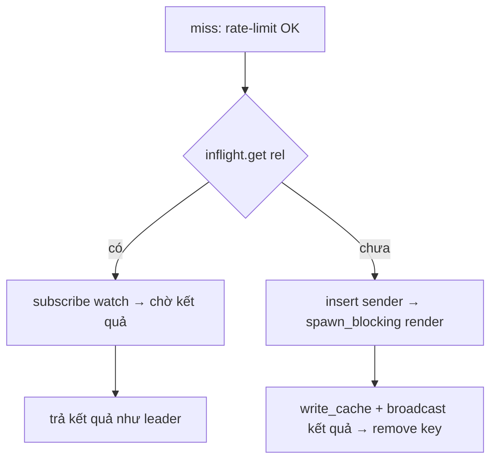

# Phase 3: Single-flight miss render

## Overview

N request miss cùng 1 slug hiện render N lần (comment trong
`admin.rs` ~dòng 1072 đã tự ghi nhận "per-path render lock — deliberately
deferred"). Đây là nguồn stampede sau mỗi `bust_cache` dưới traffic cao,
và là residual window của race delete-vs-late-write.

## Key Insights

- Render đã chạy trong `spawn_blocking` (`mod.rs:553`) — chỗ đúng để
  gắn single-flight là *quanh* spawn đó, key theo cache-rel path
  (`{clean}/index.html`), không phải theo slug DB.
- `.md` render (`md_for_slug` → `write_cache` index.md) cũng có cùng
  vấn đề — gom chung mechanism.
- `public_root` (`mod.rs:347`) cũng render + `write_cache` — cùng join.
- Kết quả cần share được giữa các waiter: leader render xong → follower
  lấy kết quả (hoặc re-serve từ file vừa ghi). Đơn giản nhất: follower
  đợi leader xong rồi **đọc lại cache file** — tận dụng luôn atomic
  write_cache, không phải truyền HTML qua channel.
  - Caveat: render trả canonical khác req → 301. Follower phải nhận được
    tín hiệu "leader redirect, đừng đọc file" — nên share kết quả enum
    `{Rendered(html-status-canonical) | NotFound | Redirect(canonical)}`
    qua `tokio::sync::watch`/`OnceCell`, không chỉ re-đọc file.

## Architecture

- Map: `DashMap<String /*rel*/, watch::Sender<RenderOutcome>>` hoặc
  `Mutex<HashMap>` — kiểu đã dùng trong project là `parking_lot::Mutex` +
  `Arc`. Chọn `watch` vì follower nhận clone của outcome cuối.
- Lock order: inflight map lock chỉ giữ cho get/insert ngắn — không giữ
  qua render (giống nguyên tắc `Bridges`).
- Cleanup: leader remove key khi broadcast xong; key theo rel-path (đã
  normalize) nên không đụt map theo slug biến thể.

## Related Code Files

- Sửa: `src/admin/mod.rs` — `SiteCtx` (thêm `inflight` field),
  `public_page`, `public_root`, `.md` branch
- Có thể tách `src/admin/inflight.rs` nếu mod.rs đã dài — quyết định
  theo convention file hiện tại (bridge đã tách module riêng)

## Implementation Steps

1. Thêm `pub(crate) inflight: Inflight` vào `SiteCtx`, init trong `serve`.
2. Định nghĩa `RenderOutcome` (Clone): `Rendered(String)`, `NotFound`,
   `Redirect(String)` — đủ để follower reconstruct response.
3. Trong `public_page` sau rate-limit + normalization: compute rel
   (`{clean}/index.html`), check map; có → await watch, respond theo
   outcome; không → insert + spawn_blocking render + write_cache +
   broadcast + remove.
4. Áp dụng tương tự cho `.md` branch (key `{clean}/index.md`) và
   `public_root` (key `index.html`).
5. Draft/non-publish: leader broadcast `NotFound` — follower không
   write_cache (đã đúng, chỉ leader ghi).
6. Drop order: sender sống trong map; nếu leader task panic trước
   broadcast → remove key trong guard Drop để follower không chờ vĩnh viễn
   (watch sender drop → recv trả Err → follower tự render lại hoặc 404 —
   chọn render lại: an toàn hơn, hiếm xảy ra).

## Todo

- [ ] `Inflight` map + `RenderOutcome` type
- [ ] `public_page` html path qua single-flight
- [ ] `.md` branch qua single-flight
- [ ] `public_root` qua single-flight
- [ ] Leader-panic path: key cleanup, follower fallback
- [ ] Test: 50 concurrent miss cùng slug → đếm render = 1 (counter qua
      hook test hoặc mtime/log)
- [ ] `cargo test` pass

## Success Criteria

- Repro #4 phase-01: burst 50 concurrent → đúng 1 render thực thi
  (verify bằng instrumentation hoặc response-time distribution:
  49/50 request trả sau khi leader xong, không ai render song song).
- `bust_cache` + traffic mô phỏng không còn N×render.

## Risk Assessment

- Follower kẹt nếu leader treo render: spawn_blocking không timeout sẵn —
  chấp nhận (giống hành vi hiện tại, mỗi request tự render cũng treo);
  không thêm timeout mới ở phase này.
- Key bằng rel-path: hai URL alias cùng slug vẫn render 2 lần (canonical
  gate 301 phần lớn alias trước đó) — chấp nhận, scope đúng là per-path.

## Security Considerations

- Không mở rộng bề mặt: outcome là kết quả render đã qua gate publish +
  canonical; follower nhận đúng thứ leader sản xuất.
- Rate-limit vẫn đếm mỗi request (kể cả follower) — single-flight giảm
  CPU, không mở throttle.
